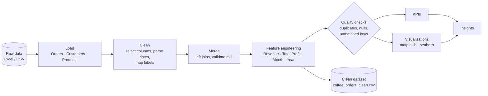

<div align="center">

# ☕ Coffee Orders Analytics

### End-to-end data cleaning, KPI analysis and visualization of coffee sales


</div>

---

## 📑 Table of Contents

- [Overview](#-overview)
- [Objectives](#-objectives)
- [Architecture](#-architecture)
- [Project Structure](#-project-structure)
- [Dataset & Data Dictionary](#-dataset--data-dictionary)
- [Data Cleaning](#-data-cleaning)
- [Dashboard & Visualizations](#-dashboard--visualizations)
- [Getting Started](#-getting-started)
- [Tech Stack](#-tech-stack)
- [Author](#-author)

---

## 🔎 Overview

This project analyzes **1,000 coffee order lines** placed by customers in the **United States, Ireland and the United Kingdom** between **2019 and 2022**. The raw data comes from an Excel workbook with three related sheets (`Orders`, `Customers`, `Products`).

The notebook `dashboard_clean.ipynb` loads the raw data, cleans and enriches it, validates its quality, computes business KPIs, and produces a set of charts that answer common sales questions.

---

## 🎯 Objectives

- Rebuild a clean, analysis-ready table from three raw sheets
- Compute **Revenue** and **Profit** correctly (unit price × quantity, unit profit × quantity)
- Validate data quality (duplicates, unmatched keys, invalid quantities, missing values)
- Track sales over time, by coffee type, roast, country and customer
- Measure the effect of the **loyalty card** on revenue per customer
- Export a clean dataset reusable in BI tools such as Power BI

---

## 🏗 Architecture



---

## 📁 Project Structure

| Path | Type | Description |
|------|------|-------------|
| `dashboard_clean.ipynb` | Notebook | Full pipeline: loading, cleaning, checks, KPIs and charts |
| `data/` | Folder | Raw (uncleaned) dataset in Excel and CSV format |
| `data/coffeeOrdersData.xlsx` | Data | Raw workbook with the 3 sheets: Orders, Customers, Products |
| `data/coffeeOrdersData.csv` | Data | Raw data in CSV format |
| `images/` | Folder | Exported charts used in this README |
| `README.md` | Doc | Project documentation |

```text
coffee-orders-analytics/
├── data/
│   ├── coffeeOrdersData.xlsx
│   └── coffeeOrdersData.csv
├── images/
├── dashboard_clean.ipynb
└── README.md
```

> 🖼️ **Note:** all the images displayed in this README are stored in the [`images/`](images/) folder.

---

## 📊 Dataset & Data Dictionary

> ⚠️ The files in `data/` are the **raw, uncleaned** versions. All cleaning is done inside the notebook.

The workbook contains three related sheets:

| Sheet | Rows (approx.) | Key | Content |
|-------|----------------|-----|---------|
| `Orders` | 1,000 | `Order ID` + `Product ID` | One row per product in an order |
| `Customers` | one per customer | `Customer ID` | Customer details and loyalty status |
| `Products` | one per product | `Product ID` | Coffee type, roast, size, price, unit profit |

### Data dictionary (clean dataset)

| Column | Type | Source | Description |
|--------|------|--------|-------------|
| `Order ID` | string | Orders | Order identifier (an order can contain several products) |
| `Order Date` | datetime | Orders | Date the order was placed |
| `Customer ID` | string | Orders | Customer identifier (foreign key to Customers) |
| `Product ID` | string | Orders | Product identifier (foreign key to Products) |
| `Quantity` | int | Orders | Number of units ordered |
| `Customer Name` | string | Customers | Customer full name |
| `Email` | string | Customers | Customer email (some values are missing) |
| `Country` | string | Customers | United States, Ireland or United Kingdom |
| `Loyalty Card` | string | Customers | `Yes` / `No` |
| `Coffee Type` | string | Products | Robusta, Excelsa, Arabica or Liberica |
| `Roast Type` | string | Products | Light, Medium or Dark |
| `Size` | float | Products | Package size in kg (0.2, 0.5, 1, 2.5) |
| `Unit Price` | float | Products | Price of one package (USD) |
| `Revenue` | float | **Computed** | `Unit Price × Quantity` |
| `Total Profit` | float | **Computed** | `Profit per unit × Quantity` |
| `Month` | datetime | **Computed** | First day of the order month |
| `Year` | int | **Computed** | Order year |

---

## 🧹 Data Cleaning

The main cleaning and correctness steps performed in the notebook:

| Step | Problem | Solution |
|------|---------|----------|
| 1 | The `Orders` sheet contains empty lookup columns | Keep only the 5 real columns and rebuild the rest from `Customers` and `Products` |
| 2 | Possible duplicate keys in lookup tables | Merge with `validate="m:1"` |
| 3 | Coded values (`Rob`, `L`, ...) | Map to readable labels (Robusta, Light, ...) |
| 4 | `Profit` in `Products` is **per unit**, not sales | Compute `Revenue = Unit Price × Quantity` and `Total Profit = Profit × Quantity` |
| 5 | Dates stored as text would break time analysis | Keep a real `datetime` and derive `Month` / `Year` |
| 6 | Missing emails | Keep as `NaN` (no `fillna("")`, which would corrupt dtypes) |
| 7 | No validation | Check duplicates, unmatched customers/products and `Quantity <= 0` |

```python
df = (orders
      .merge(customers, on="Customer ID", how="left", validate="m:1")
      .merge(products,  on="Product ID",  how="left", validate="m:1"))

df["Revenue"]      = df["Unit Price"] * df["Quantity"]
df["Total Profit"] = df["Profit"] * df["Quantity"]
df["Month"]        = df["Order Date"].dt.to_period("M").dt.to_timestamp()
```

---

## 📈 Dashboard & Visualizations

The notebook produces the following charts (saved in [`images/`](images/)):

### Monthly revenue and profit


### Yearly revenue


### Revenue by coffee type, country and roast


### Country × coffee type heatmap


### Revenue trend by coffee type (3-month moving average)


### Top customers and loyalty card effect


### KPIs computed

| KPI | Definition |
|-----|------------|
| Total revenue | Sum of `Revenue` |
| Total profit | Sum of `Total Profit` |
| Profit margin % | Total profit ÷ total revenue × 100 |
| Orders | Number of unique `Order ID` |
| Customers | Number of unique `Customer ID` |
| Average order value | Mean of revenue per `Order ID` |

---

## 🚀 Getting Started

### 1. Clone the repository

```bash
git clone https://github.com/<your-username>/<your-repo>.git
cd <your-repo>
```

### 2. Install the dependencies

```bash
pip install pandas matplotlib seaborn openpyxl jupyter
```

### 3. Launch the notebook

```bash
jupyter notebook dashboard_clean.ipynb
```

### 4. Check the data path

The raw files are in the `data/` folder, so make sure the path at the top of the notebook points to it:

```python
FILE = "./data/coffeeOrdersData.xlsx"
```

Run all cells. The notebook also exports `coffee_orders_clean.csv`.

---

## 🛠 Tech Stack

| Tool | Usage |
|------|-------|
| Python | Main language |
| pandas | Loading, cleaning, merging, aggregation |
| Matplotlib | Charts |
| Seaborn | Statistical plots and heatmap |
| openpyxl | Reading the Excel workbook |
| Jupyter Notebook | Interactive analysis |

---

## 👤 Author

**Hamza** — Computer Science student, École Supérieure de Technologie – Safi

- GitHub: [@your-username](https://github.com/your-username)
- LinkedIn: [your-profile](https://www.linkedin.com/in/your-profile)

---

<div align="center">

⭐ If you found this project useful, consider giving it a star.

</div>
